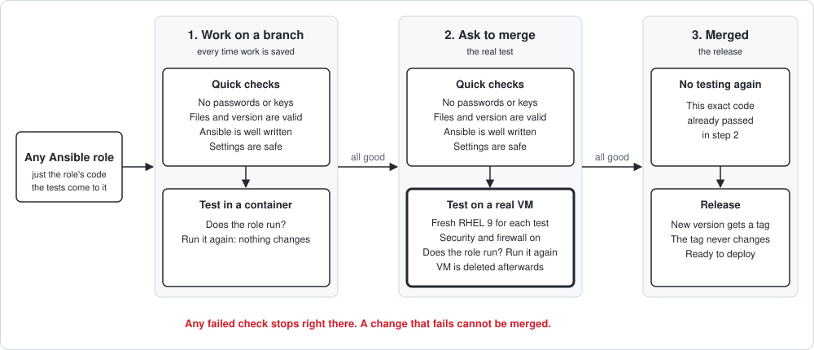

# ansible-pipeline

Central CI for Ansible roles. A role repo holds only role code. Jenkins brings the pipeline and the Molecule tests from this repo, tests every branch and pull request, runs pull requests on a real RHEL 9 VM, and tags releases from `main`.

- **For role authors:** [docs/ci/onboarding-a-role.md](docs/ci/onboarding-a-role.md) — what your repo needs and how to get it built.
- **For the Jenkins admin:** [docs/ci/setup-guide.md](docs/ci/setup-guide.md) — build this CI from scratch, one line per step.
- **Proof:** [docs/ci/evidence.md](docs/ci/evidence.md) (real output of every check) · [docs/ci/troubleshooting.md](docs/ci/troubleshooting.md) (errors met, cause, fix) · [docs/PLAN.md](docs/PLAN.md) (batches and decisions).

## How it works



| Event | Runs | Time |
| --- | --- | --- |
| Push to a branch with no PR | Gates + container test | about 1 minute |
| PR opened or updated | Gates + **VM test** | about 4 minutes |
| Merge to `main` | **Release only** | seconds |

A branch with an open PR builds as the PR only. `main` needs no tests: the PR must be green and up to date, so it merges exactly what was tested.

The pipeline never names a role: Jenkins fills `scm` with the role, branch and commit being built, so the same file serves every role.

## Gates

Gates 1–5 run on branches and PRs, cheapest first; the first red stage stops the build. Proof is in [evidence.md](docs/ci/evidence.md); the drills ran on the earlier layout, when Molecule still lived in the role.

| Stage | Tool | Catches | Proven by | If it is red |
| --- | --- | --- | --- | --- |
| Secrets | gitleaks 8.30.1 | Keys and tokens anywhere in the branch's history, value redacted in the log | Drill 4: key found, still found after a revert commit | Revoke the secret first, then remove the commit from the branch and force-push |
| Version | `grep` | `VERSION` that is not `X.Y.Z` | PR #2 (merged before this stage existed, broke `main`) | Fix `VERSION` in the pull request |
| YAML lint | yamllint 1.38.0 | Broken YAML: indentation, syntax | Drill 1 | Fix the file and line printed (`file:line:col`) |
| Ansible lint | ansible-lint 26.11.0, profile `production` | Unknown modules, bad Ansible practice (`shell` for a package, no `changed_when`) | Drills 2 and 3 | Read the rule name; its docs link explains the fix |
| Security | Checkov 3.4.3 | Insecure settings such as `validate_certs: false` | Drill 5 | Fix the setting; skip only with a reason inside the task (`# checkov:skip=ID: reason`) |
| Container test | Molecule 26.9.0, Podman, `ubi9-init` | The role does not run or is not idempotent (branch builds) | Drill 7 | Read the failing step and task in the console |
| VM test | Molecule, Terraform, KVM | The same, on real RHEL 9: SELinux enforcing, firewalld on, packages from Red Hat (PR builds) | `PR-4` #2, green run only | Read the failing task in the console |
| Release | git | — (`main` only): tags the PR's commit `v<VERSION>`; skips if the tag exists, or if the commit is not a PR merge | `v0.1.1` from `main` #9; skip on #8 | 403 on push: the token needs Contents write |

Molecule only proves the role runs and is idempotent: there is no verify step for now. Checking what the role does belongs to a separate audit.

After every branch and PR build, `post` removes any container or VM left by an abort and archives `reports/` (gitleaks and ansible-lint SARIF, Checkov JUnit XML).

## Branches, pull requests and releases

- **Every branch** with `meta/main.yml` is built; GitHub shows `continuous-integration/jenkins/branch`.
- **A pull request** is built instead of its branch and shows `continuous-integration/jenkins/pr-head`.
- **`main`** accepts changes only through a pull request whose `pr-head` check is green and whose branch is up to date with `main`, merged with a merge commit. No force push, no deletion, no bypass (GitHub ruleset). The release relies on this ruleset.
- **To release:** change `VERSION` in the pull request. After the merge, `main` tags `v<VERSION>`. Tags `v*` cannot be moved or deleted (GitHub ruleset).
- **Use a release:**

  ```yaml
  # requirements.yml
  roles:
    - name: bunnywkwk.webserver
      src: https://github.com/bunnywkwk/ansible-role-webserver.git
      scm: git
      version: v0.1.0
  ```

## Build it yourself

Full commands in the [setup guide](docs/ci/setup-guide.md); in short:

1. Two public GitHub repos: `ansible-pipeline` (this) and a role repo.
2. A fine-grained token for the role repos: Contents read and write, Metadata and Pull requests read, Commit statuses read and write.
3. Build node: subordinate IDs and linger for `jenkins` (rootless Podman), `/opt/ci` and `/opt/checkov` venvs from `ci/requirements-*.txt`, gitleaks binary (checksum verified), Terraform, `jenkins` in group `libvirt`, the RHEL 9 golden image in libvirt pool `ci`.
4. Jenkins: plugins (GitHub Branch Source, Remote Jenkinsfile Provider, …), label `ansible` on the build node, credentials `github-crendentials`, `rhsm-org`, `rhsm-activation-key`, folder `role-ci`.
5. Per role repo: a multibranch job in "Remote Jenkins File Provider" mode, marker `meta/main.yml`, Jenkinsfile from this repo's `main`, no pull requests from forks.
6. Webhook through a smee channel, smee client as a user service.
7. GitHub rulesets: role `main` (PR + `pr-head` + up to date, merge commits only), role tags `v*` (no update or delete), this repo's `main` (no force push or delete).

## Repo layout

| Path | Holds |
| --- | --- |
| `Jenkinsfile` | The pipeline, for every role |
| `ci/molecule/default/` | Container test scenario, copied into every branch build |
| `ci/molecule/vm/` | VM test scenario and its Terraform, copied into PR builds |
| `ci/requirements-tools.txt` | Pinned ansible-core 2.16, ansible-lint, yamllint, Molecule (`/opt/ci`) |
| `ci/requirements-checkov.txt` | Pinned Checkov (`/opt/checkov`, own venv: its pins clash with the tools above) |
| `docs/` | Plan, setup guide, onboarding, evidence, troubleshooting |
