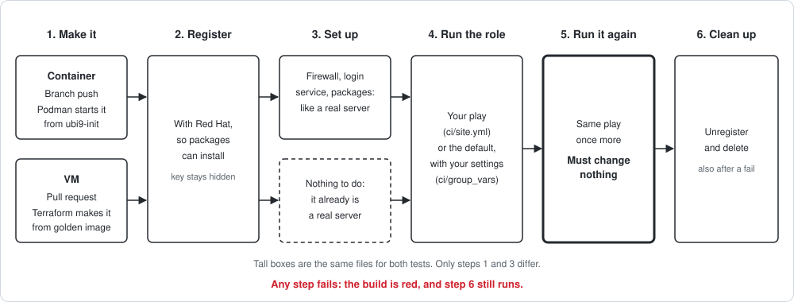

# Use the central CI for your role

How to get a role repo built and released by [ansible-pipeline](../../README.md). You write role code only. The pipeline and the tests come from `ansible-pipeline`. You do not need a VM: the PR test creates one for you.

> **Status:** used for two roles, `ansible-role-webserver` and `ansible-role-motd`; report anything here that does not work.

## 1. Start the repo

Name it `ansible-role-<name>`, public, on GitHub. Copy the layout of [ansible-role-webserver](https://github.com/bunnywkwk/ansible-role-webserver):

```text
ansible-role-<name>/
├── meta/main.yml            # required: the marker; no meta/main.yml, no build
├── meta/argument_specs.yml  # variable types, checked before tasks run
├── defaults/main.yml
├── tasks/main.yml
├── handlers/main.yml        # if needed
├── templates/               # if needed
├── requirements.yml         # only if the role uses collections
├── ci/                      # optional: your test play and site variables (section 2)
├── VERSION                  # X.Y.Z, e.g. 0.1.0
└── README.md
```

That is all. No `molecule/` folder: the pipeline's copy is used, and replaces any you add.

Do **not** add a `Jenkinsfile`: it would be ignored (Batch 3 drill 8).

## 2. Files the pipeline depends on

**`meta/main.yml`** — `namespace` and `role_name` give the role its full name, `<namespace>.<role_name>`:

```yaml
galaxy_info:
  author: <you>
  namespace: <namespace>
  role_name: <name>
  min_ansible_version: "2.16"
  platforms:
    - name: EL
      versions: ["9"]
```

The pipeline reads that name and runs your role under it. A `meta/main.yml` without `namespace` or `role_name` fails the build at `Test setup`.

**`requirements.yml`** — every collection the role uses; no collections, no file. CI starts from an empty collection set; a missing entry fails the test there even if it passes on your machine.

**Optional: a `ci/` folder**, to run the role like a real site. Without it, the tests run your role with its defaults.

```text
ci/
├── site.yml                 # your play, used instead of the pipeline's; every play must be hosts: all
└── group_vars/
    ├── all.yml              # site variables, both tests
    ├── container.yml        # container test only (branch builds)
    └── vm.yml               # VM test only (pull requests)
```

```yaml
# ci/site.yml: name the role in full, as in meta/main.yml
---
- name: Deploy like a site
  hosts: all
  roles:
    - role: bunnywkwk.registry
```

Each file is optional. The test host is in group `container` or `vm`, so the usual rule applies: the group file wins over `all.yml`, and both win over your `defaults/`. `hosts: all` is checked at `Test setup`: the test host is the only target.

**Optional:** a `.yamllint`, `.ansible-lint`, `.gitleaks.toml` or `.checkov.yml` in the repo root changes that tool's rules for your role only. Without one, the tool's defaults apply.

## 3. Check locally before you push

With the same tools as CI (`/opt/ci`, see the setup guide):

```bash
. /opt/ci/bin/activate
yamllint . && ansible-lint --profile production && /opt/checkov/bin/checkov -d . --framework ansible --skip-download
```

The role itself is run by CI, not locally: the tests are not in your repo.

## 4. Ask the Jenkins admin to connect the repo

Three one-time steps, no pipeline change ([setup guide](setup-guide.md), "Adding another role repo"):

1. Add the repo to the GitHub token's repository access.
2. Create its multibranch job in `role-ci` (Remote Jenkins File Provider mode, marker `meta/main.yml`).
3. Add the smee webhook (JSON, Pushes and Pull requests) and the rulesets for `main` and tags `v*`.

## 5. Work through pull requests

1. Push a feature branch: Jenkins runs the gates and a container test, and the commit shows ✓ or ✗.
2. Open a pull request to `main`: Jenkins runs the gates and the role on a real RHEL 9 VM. `continuous-integration/jenkins/pr-head` must be green, with the branch up to date, before it can merge.
3. Red? Open the build's console (link on the ✗). The failed stage says what to fix; see the gate table in the [README](../../README.md#gates).

Both tests run your role the same way, with your `ci/` settings; only the machine differs:



In the PR console, look for `== Run 1`, `== Run 2` and `Idempotence: changed=0`.

## 6. Release

Change `VERSION` (e.g. `0.1.0` → `0.2.0`) in the pull request. After the merge, the `main` build tags `v0.2.0` on the tested commit. A merge without a `VERSION` change releases nothing (`release skipped`). Released tags cannot be moved or deleted.

Users install a release by tag:

```yaml
roles:
  - name: <namespace>.<name>
    src: https://github.com/<owner>/ansible-role-<name>.git
    scm: git
    version: v0.2.0
```
